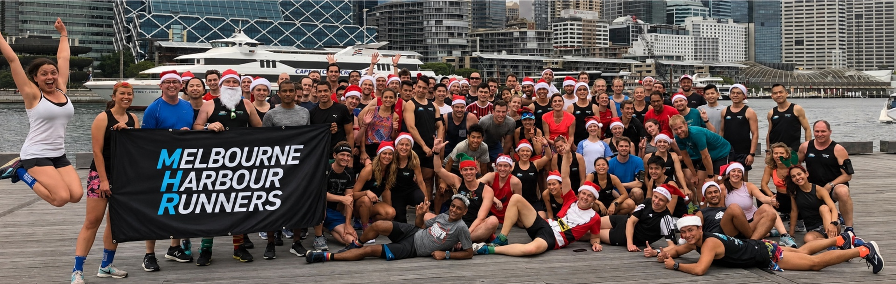

 
 

Sydney Harbour Runners are a community of runners, and we make our SHR run nights relaxed and social. There is a pace group for most runners, and we welcome all new runners to come along.

Weekly group runs are FREE and we meet on **Tuesdays from 6:00pm** at the [Cockle Bay Wharf Bird Fountain]({{ site.meeting_point_url }}) in Darling Harbour (Sydney CBD).

- Two distance options: short course around 6km-8km, long course around 11km-13km
- Pace groups from 4:30 to 6:15 min/km - our routes for each week are shown [here](/schedule)
- Bag drop available
- Post-run meals and drink specials
- Runs leave 6:15pm from the Cockle Bay Wharf Bird Fountain

#### When & Where do you meet?

Tuesdays at 6:00pm starting at the [Cockle Bay Wharf Bird Fountain]({{ site.meeting_point_url }}) in Darling Harbour

#### How do I join?

Just rock up! There is no need to register and we are 100% free to join.

#### Any questions?

Please join the [Sydney Harbour Runners Facebook group](https://www.facebook.com/groups/sydneyharbourrunners/) and make a post!
